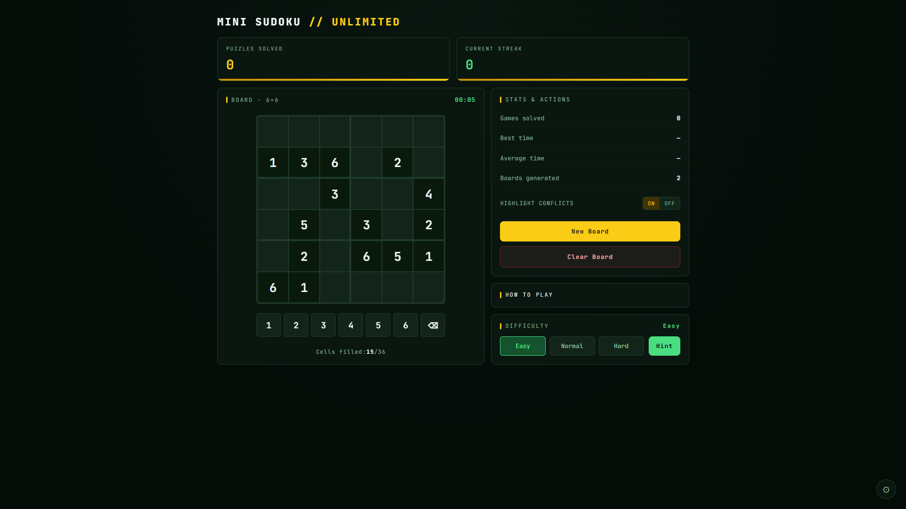

# Mini Sudoku Unlimited

A minimalist 6x6 Mini Sudoku puzzle game with unlimited boards, smart assists, and difficulty levels.

**Live site:** https://mini-sudoku-unlimited.vercel.app

## How to Play

- Fill the grid with numbers 1 to 6
- Every row and every column must contain unique numbers
- Every 2x3 block separated by thick lines must contain unique numbers
- Completing a row, column or block locks in its correct answers

## Features

- Unlimited boards with Easy, Normal and Hard difficulties
- Hint button and optional conflict highlighting
- Timer with solve count, best time, average time and streaks
- On-screen number pad, dark and light themes
- High contrast and color-blind modes, reduced motion and sound effects

## Tech Stack

- [Vite](https://vite.dev/)
- React
- TypeScript
- Hosted on [Vercel](https://vercel.com)
